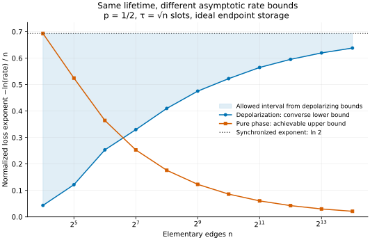

# The same lifetime can give a different rate exponent

Keep the Bell-link architecture, synchronized source attempts, endpoint resources and interior coherence attenuation fixed. Change the memory channel from depolarization to pure phase dephasing. Write $`R_n^{\rm dep}=R_n`$ for the original operational rate and $`R_n^{\rm phase}`$ for the same definition with the changed channel. The [ASAP/reset protocol](achievability.md) then has the same classical variables

```math
T_n=\max_iG_i,
\qquad A_n=\sum_{i=1}^{n-1}|G_i-G_{i+1}|,
\qquad \mu_p=\frac{2(1-p)}{p(2-p)},
```

but its raw state has a different Bell spectrum.

The independent channel acting for time $`s`$ on each occupied interior qubit is now

```math
\mathcal P_s(X)=\frac{1+e^{-s/\tau}}2X
 +\frac{1-e^{-s/\tau}}2\sigma_z X\sigma_z.
```

Its off-diagonal matrix entries decay by $`e^{-s/\tau}`$, the same factor as under the depolarizing channel. The product-process and inaccessible-environment assumptions of the model are retained. Write $`\Phi^{\pm}=|\phi^{\pm}\rangle\langle\phi^{\pm}|`$, with $`|\phi^{\pm}\rangle=(|00\rangle\pm|11\rangle)/\sqrt2`$; thus $`\Phi^+=\Phi_2`$.

## Phase coherence remains distillable at every positive visibility

A phase-noisy cycle of age $`A_n`$ produces

```math
Z(v)=\frac{1+v}{2}\Phi^+
     +\frac{1-v}{2}\Phi^-,
\qquad v=e^{-A_n/\tau}.
```

After discarding timing records, the average raw state is $`Z(\bar v_n)`$, with

```math
\bar v_n=\mathbb E e^{-A_n/\tau}
\ge e^{-(n-1)\mu_p/\tau}.
```

Bell-diagonal [one-way hashing](../references/RELATED_WORK.md#bdsw96) gives

```math
D_{\rm phase}(v)=1-h_2\!\left(\frac{1+v}{2}\right)
\ge\frac{v^2}{2\ln2}.
```

The last inequality follows from binary Pinsker, or by integrating the entropy's second derivative. It is positive for every $`v\gt0`$. The deterministic-horizon timing lemma, which permits duration-quality correlation and charges deadline failures, yields

```math
\boxed{
R_n^{\rm phase}(\tau,p)
\ge
\frac{\exp[-2(n-1)\mu_p/\tau]}{2\ln2\,\mathbb ET_n}.
}
```

One may take the maximum of this lower bound and $`p^n`$, since synchronized generation also produces perfect pairs in the phase-noise model.

The one-edge source budget also gives $`R_n^{\rm phase}\le p\le1`$: every raw delivery consumes a distinct success on that edge and carries at most one ebit. For every diverging lifetime sequence $`\tau_n\to\infty`$,

```math
0\le -\frac1n\ln R_n^{\rm phase}(\tau_n,p)
\le
\frac{2(n-1)\mu_p}{n\tau_n}
+\frac{\ln(2\ln2\,\mathbb ET_n)}n
\longrightarrow0.
```

In particular, $`\tau_n=n^\alpha`$, $`0\lt\alpha\lt1`$, gives an explicit stretched-exponential achievable rate. This can still be very small. The statement concerns the leading exponent and does not guarantee a useful rate uniform in distance or a practical finite distillation block length.

For depolarizing memories, the [adaptive converse](adaptive_converse.md) gives the strictly different result

```math
\tau_n=o(n)
\quad\Longrightarrow\quad
-\frac1n\ln R_n^{\rm dep}(\tau_n,p)\longrightarrow\ln(1/p).
```

Thus identical diverging sublinear lifetimes can have different leading entanglement-rate exponents. A scalar coherence lifetime is insufficient to specify this asymptotic rate. The depolarizing argument uses a finite separability threshold: $`W(v)`$ is separable at $`v\le1/3`$. Pure phase coherence remains distillable for every positive $`v`$.

## Finite-chain illustration

The accompanying figure evaluates analytic bounds for $`p=1/2`$ and $`\tau_n=\sqrt n`$. The depolarizing shaded interval is bounded below in exponent by the exact integer-profile converse and above by synchronized generation. The phase curve is an upper bound on its exponent from the displayed achievable rate. These are bounds, not an estimate of either optimized rate.



| Edges $`n`$ | Depolarizing exponent is at least | Phase exponent is at most | Synchronized exponent |
| ---: | ---: | ---: | ---: |
| 128 | 0.3297431 | 0.2529820 | 0.6931472 |
| 512 | 0.4752736 | 0.1228203 | 0.6931472 |
| 2,048 | 0.5647316 | 0.0602830 | 0.6931472 |
| 8,192 | 0.6197142 | 0.0298241 | 0.6931472 |
| 16,384 | 0.6381920 | 0.0210186 | 0.6931472 |

Even the conservative finite bounds separate the models at $`n=128`$.

## Reproducible calculation

The script [`repeater_bounds.py`](../verification/repeater_bounds.py) evaluates the exact integer ball

```math
K(n,a)=\sum_{j=0}^{\min(n-1,a)}2^j\binom{n-1}{j}\binom aj,
\qquad a=\lceil\tau\ln3\rceil-1,
```

and performs a deterministic positive transfer recursion for ASAP visibility. It uses no Monte Carlo. For a cutoff $`L`$, set $`w_s=p(1-p)^{s-1}`$, $`1\le s\le L`$. Then

```math
z_s^{(1)}=w_s,
\qquad
z_s^{(k+1)}=w_s\sum_{t=1}^{L}e^{-|s-t|/\tau}z_t^{(k)}.
```

The sum of the final vector includes every history whose source times do not exceed $`L`$. The omitted visibility is at most

```math
\Pr(T_n\gt L)=1-(1-q^L)^n\le nq^L.
```

The remaining tail in the duration sum is at most $`nq^L/p`$. Both support errors are chosen below $`10^{-14}`$. Binary64 roundoff is not enclosed by interval arithmetic; the reported decimal values are numerical evaluations of the exact analytic bounds.

The CSV also compares depolarizing and phase hashing yields at the identical average visibility and duration. Zero depolarizing entries are zero lower bounds for the indicated timing-forgetting factory and distillation construction. They do not assert that timing-aware selection or a different allowed policy has zero rate.
